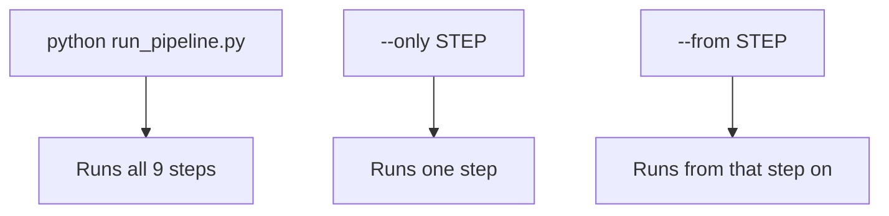

# 11 · Setup, Run, and Test

How to install, run, and check the project. Works on Windows (PowerShell shown); macOS/Linux is the same with a different activate line.

## 1. Set up (once)

```powershell
python -m venv .venv
.\.venv\Scripts\Activate.ps1      # macOS/Linux: source .venv/bin/activate
pip install -r requirements.txt
```

Needs Python 3.11. Check it worked: `python -c "import pandas, duckdb, statsmodels; print('ok')"`.

## 2. Run the pipeline



Three ways to run: everything, one step, or from a step onward.

- Full run: `python run_pipeline.py` (about 10 minutes; first run downloads ~440 MB).
- One step: `python run_pipeline.py --only descriptives`
- Resume: `python run_pipeline.py --from models`

Step order: `download → harmonise → validate → build_db → descriptives → models → robustness → dashboard → memo`.

## 3. Test / verify

- **Built-in check (fast):** `python run_pipeline.py --only validate`. It checks row counts, duplicate IDs, and that the numbers match Stack Overflow's official tables. It **stops the pipeline** if anything fails, and writes `reports/tables/benchmark_check.csv`.
- **Look at the outputs:**
  - Dashboard: open [dashboard/ai_trust_dashboard.html](../dashboard/ai_trust_dashboard.html).
  - Memo: [reports/insight_memo.pdf](../reports/insight_memo.pdf).
- **Full reproducibility test:** delete `data/interim/` and `data/processed/`, then run `python run_pipeline.py` and confirm the numbers come out the same.

## 4. Notebooks (optional)

[notebooks/](../notebooks/) (`01`–`04`) walk through exploration, descriptives, regression, and robustness interactively. Run them after the pipeline has produced `respondents.parquet`.

## Troubleshooting

- **Unmapped label error during `harmonise`** — a new answer label is missing from [value_maps.yaml](../mappings/value_maps.yaml). Add it there (see [05-harmonisation-and-crosswalk.md](05-harmonisation-and-crosswalk.md)).
- **No PDF from `memo`** — Edge/Chrome was not found. The HTML is still written; open it and print to PDF.
- **Re-download the data** — delete the year folder in `data/raw/` and run `python run_pipeline.py --only download`.
